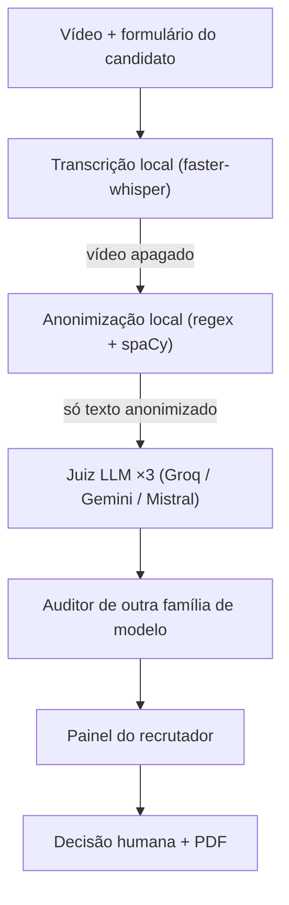

# TalentVisor

Triagem de candidatos a **Advogado(a) Júnior** por soft skills, a partir das respostas em vídeo. A IA recomenda, com cada nota ligada ao trecho exato da fala que a justifica. **A decisão é sempre de uma pessoa.**

MVP acadêmico da disciplina "Agentes Autônomos de IA" (IDP). Tudo roda em Docker, na sua máquina, em `127.0.0.1`.



---

## 1. O que você precisa

| Item | Para quê | Como conferir |
|---|---|---|
| **Docker** com Docker Compose v2 | roda tudo (app, testes, import) | `docker compose version` |
| **make** | atalhos de operação | `make --version` |
| **git** | baixar o projeto | `git --version` |
| ~10 GB de disco livre e 8 GB de RAM | a imagem tem ~5,2 GB (modelo de transcrição embutido) + camadas de build | `df -h` |
| Conta gratuita na **Groq** e no **Google AI Studio** | modelos de linguagem na nuvem | seção 2 |
| Conta gratuita na **Mistral** (opcional) | reserva quando a cota das outras acaba | seção 2 |

Não precisa de Python na sua máquina: nada roda fora do Docker. Não precisa de GPU: a transcrição roda em CPU (um vídeo de 4 min leva cerca de 1,5 a 2 min).

> [!NOTE]
> Quer só ver as telas, sem chave nenhuma? Pule a seção 2 e use `LLM_MODE=mock` (seção 3). O app funciona inteiro com respostas de teste.

## 2. Pegar as chaves de API (gratuitas)

O app usa três provedores. Os dois primeiros são necessários para avaliar de verdade; o terceiro é reserva.

### 2.1 Groq (juiz principal, `GROQ_API_KEY`)

1. Acesse https://console.groq.com e entre com Google ou GitHub.
2. Menu **API Keys** → **Create API Key** → dê um nome (ex.: `talentvisor`).
3. Copie a chave. Ela começa com `gsk_` e só aparece uma vez.

Plano gratuito: limite por minuto e por dia em cada modelo. Uma avaliação gasta ~20 mil tokens; a cota diária dá para algumas avaliações por dia.

### 2.2 Google Gemini (auditor e reserva, `GEMINI_API_KEY`)

1. Acesse https://aistudio.google.com/apikey e entre com uma conta Google.
2. **Create API key** → escolha (ou crie) um projeto.
3. Copie a chave. Ela começa com `AIza`.

Plano gratuito com cota diária. Se o modelo principal (`gemini-4-hydrogen`) esgotar, o app usa o `gemini-3.5-flash-lite` sozinho.

### 2.3 Mistral (reserva opcional, `MISTRAL_API_KEY`)

1. Acesse https://console.mistral.ai e crie a conta.
2. **Admin → Subscription**: confirme o plano **Free** (pode pedir verificação por telefone; não pede cartão).
3. **API Keys → Create new key** → copie a chave.
4. **Admin → Privacy**: desligue o uso dos seus dados para treinar modelos.

No plano gratuito só os modelos `ministral-*` respondem (2 requisições por minuto). O app já usa `ministral-14b-2512` e espera sozinho quando bate o limite.

> [!WARNING]
> Chave é senha. Ela vai **só** no arquivo `.env`, que o git ignora. Nunca cole chave em issue, print, commit ou chat.

## 3. Configurar

```bash
git clone <url-do-repositorio> TalentVisor
cd TalentVisor
cp .env.example .env
```

Abra o `.env` no seu editor e preencha as chaves:

```bash
GROQ_API_KEY=gsk_sua_chave
GEMINI_API_KEY=AIza_sua_chave
MISTRAL_API_KEY=sua_chave_mistral
LLM_MODE=real
```

As demais variáveis já têm padrão e podem ficar como estão:

| Variável | Padrão | O que faz |
|---|---|---|
| `LLM_MODE` | `mock` no `.env.example` | `mock` usa respostas de teste, sem rede e sem chave; troque para `real` depois de preencher as chaves |
| `ALLOW_CLOUD_STT` | `0` | `1` libera transcrição pela Groq se a local falhar (envia o áudio; o termo passa a citar isso) |
| `M3_MODEL` | `openai/gpt-oss-20b` | segmentação das respostas (Groq) |
| `M4_MODEL` | `openai/gpt-oss-120b` | juiz principal (Groq) |
| `M5_MODEL` | `gemini-4-hydrogen` | auditor e reserva (Google) |
| `M6_MODEL` | `mistral:ministral-14b-2512` | reserva de terceira família (Mistral); mantenha o prefixo `mistral:` |
| `PROMPT_GUARD_MODEL` | `meta-llama/llama-prompt-guard-2-86m` | detector de prompt injection (Groq) |
| `JUDGE_RUNS` | `3` | quantas vezes o juiz avalia (a nota é a mediana) |
| `TRANSCRIPT_TTL_DAYS` | `7` | dias até apagar a transcrição |
| `DEMO_MODE` | `1` | na demo, dá leve preferência aos modelos da Groq (mais rápidos) |
| `STT_MODEL` | `large-v3-turbo` | modelo de transcrição; é embutido na imagem, então mudar exige `make up` de novo |

## 4. Rodar

```bash
make up
```

A primeira vez demora alguns minutos: baixa a imagem base, instala as dependências e embute o modelo de transcrição. Depois sobe em segundos.

Confira se está tudo certo:

```bash
make health
```

A resposta esperada (`HTTP 200`) mostra o banco e o modelo de transcrição prontos, e se cada chave está presente (só `true`/`false`, nunca o valor):

```json
{ "db": true, "stt_model": true, "keys": { "groq": true, "gemini": true, "mistral": true } }
```

Abra no navegador:

| Endereço | Quem usa |
|---|---|
| http://localhost:8000 | candidato: preenche os dados, aceita o termo e envia o vídeo |
| http://localhost:8000/dashboard | recrutador: lista, análise lado a lado com a fala e o formulário, decisão e PDF |

O painel não tem login (MVP local). Ele só escuta em `127.0.0.1`.

## 5. Importar o dataset de exemplo (opcional)

O dataset da disciplina (`Dataset_Advogados_Jr_Completo.zip`) tem dados **reais** e **não** vai para o git. Coloque o zip fora da pasta do projeto e rode:

```bash
make import ZIP=../Dataset_Advogados_Jr_Completo.zip
```

O import processa um candidato por vez (transcreve, anonimiza e avalia). Resultado esperado: **C001 e C003** aguardando decisão no painel e **C002 recusado** (não autorizou a análise, então nada dele é processado). Rodar de novo não duplica: só reprocessa quem terminou em erro.

> [!TIP]
> Cada avaliação real consome cota dos provedores. No dia da apresentação, importe **uma vez**, com a cota cheia, e não rode `eval.py` nem `bias_check.py` antes.

## 6. Testar

```bash
make test
```

Roda os testes (pytest) em modo `mock`, sem chaves e sem rede, mais o lint (ruff) e as checagens da documentação: links, rastreabilidade da SPEC (todo requisito com teste que existe) e os alvos do Makefile.

Avaliação de qualidade com LLM de verdade, sobre casos sintéticos (gasta cota):

```bash
docker compose run --rm -T -e LLM_MODE=real app python scripts/eval.py
docker compose run --rm -T -e LLM_MODE=real app python scripts/bias_check.py
```

Saída `exit 0` passa, `1` falha, `2` inconclusivo (provedor sem cota). Resultados de referência em [docs/evidence/](docs/evidence/).

Para conferir se cada chave e cada ID de modelo respondem (uma chamada mínima por modelo, imprime só o status):

```bash
docker run --rm --env-file .env -v "$PWD/scripts:/s:ro" python:3.14-slim python /s/check_models.py
```

## 7. Comandos do dia a dia

| Comando | Faz |
|---|---|
| `make` | lista os comandos |
| `make up` | constrói e sobe em http://localhost:8000 |
| `make down` | para tudo |
| `make status` | estado do container |
| `make health` | banco, modelo de transcrição e presença das chaves |
| `make logs` | acompanha os logs |
| `make test` | testes + lint + checagens da documentação |
| `make import ZIP=...` | importa o dataset |
| `make ops` | painel do loop de agentes em http://localhost:8001 (uso de desenvolvimento) |

Zerar o banco local (apaga candidatos, avaliações e cache de LLM):

```bash
make down
docker compose run --rm -T app rm -f data/talentvisor.db
make up
```

## 8. Problemas comuns

| Sintoma | Causa provável | O que fazer |
|---|---|---|
| `make health` com `"groq": false` | chave não está no `.env` ou o container subiu antes | confira o `.env` e rode `make down && make up` |
| `make health` dá `HTTP 503` com `"stt_model": false` | `STT_MODEL` mudou sem reconstruir a imagem | `make up` (reconstrói) |
| Candidato fica em **erro** na etapa de avaliação | cota diária dos provedores acabou (erro 429) | espere a cota renovar e reimporte; o app tenta Groq → Gemini → Mistral antes de desistir |
| Mistral responde 429 sempre, com limite 0 | plano Free não ativado na conta | console Mistral → Admin → Subscription → Free |
| Página sem estilo depois de atualizar | cache antigo do navegador | Ctrl+Shift+R (o CSS já vem com versão na URL; só acontece com versões antigas) |
| `port is already allocated` no `make up` | a porta 8000 está em uso | pare o outro serviço ou troque a porta em `compose.yaml` |
| Upload recusado | formato fora de mp4/webm/mov ou arquivo acima de 300 MB | converta ou corte o vídeo |

## 9. Privacidade (LGPD) em uma página

- O **vídeo é apagado** logo após a transcrição, mesmo se der erro. A transcrição fica 7 dias; candidato e avaliação, 30 dias; o registro de auditoria, 90 dias.
- Os modelos na nuvem recebem **só texto anonimizado**. Nome, instituição e cidade nunca saem da máquina; se o texto ainda tiver um nome conhecido, a chamada é abortada.
- Nada de rosto, voz, emoção, aparência ou postura: só o conteúdo do que a pessoa diz.
- Nenhuma decisão é automática. O nome real só aparece depois que uma pessoa aprova ou reprova.
- Candidato que não autorizou a análise é recusado sem processar nada.

Detalhes em [docs/domain/legal.md](docs/domain/legal.md).

## 10. Onde está cada coisa

| Preciso de… | Arquivo |
|---|---|
| O que o sistema faz (requisitos e aceite) | [docs/spec/spec.md](docs/spec/spec.md) |
| Como as telas funcionam | [docs/spec/ui.md](docs/spec/ui.md) |
| Modelos e roteador de LLMs | [docs/architecture/models-router.md](docs/architecture/models-router.md) |
| Por que cada decisão foi tomada | [docs/process/decisions.md](docs/process/decisions.md) |
| Sistema visual | [DESIGN.md](DESIGN.md) |
| Índice de toda a documentação | [docs/index.md](docs/index.md) |

Código em `talentvisor/` (app FastAPI, pipeline, roteador, privacidade, relatório), scripts em `scripts/`, testes em `tests/`.
