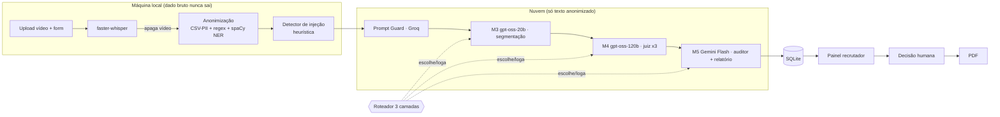

# Visão geral da arquitetura

> [Índice](../index.md) · [Stack](stack.md) · [Modelos e roteador](models-router.md) · [Modelo de dados](data-model.md) · [Estrutura](layout.md) · [SPEC](../spec/spec.md)

## Pipeline detalhado

| Etapa | O que faz | Módulo | Sensor ou atuador | Falha → |
|---|---|---|---|---|
| E0 Entrada | consentimento obrigatório, valida mime e tamanho, salva com nome uuid, bloqueia `liberado≠Sim` | app.py | sensor (parser) | 400/403 |
| E1 STT | faster-whisper com VAD e `word_timestamps`; mede a qualidade; **apaga o vídeo** | stt.py | sensor | fallback M1b (flag) ou `erro` |
| E2 Anonimização | PII do CSV → `[NOME]`, `[INSTITUICAO]`...; regex CPF/OAB/e-mail/telefone; NER PER/LOC/ORG | privacy.py | sensor e detector | n/a |
| E3 Guarda e segmentação | heurística + Prompt Guard; M3 separa P01–P05, marca vazio ou fora do tema | privacy.py, pipeline.py | detector e segmentador | injeção → flag de revisão, segue avaliando |
| E4 Juiz | M4 3× (temperatura 0,7), evidência antes da nota; mediana; desvio → confiança; hard skills, perfil, categoria | pipeline.py | classificador | cascata |
| E5 Relatório | M5 escreve pontos fortes, de atenção e evidências em PT-BR | pipeline.py | gerador | template sem LLM |
| E6 Auditoria | M5 reavalia só as notas; Δ≥2, conf<0,7 ou injeção → `revisao_humana` | pipeline.py | juiz cruzado | n/a |
| E7 Decisão | humano aprova, reprova ou pede 2ª avaliação → `audit_log`; revela o nome; libera o PDF | app.py | humano | n/a |

<!-- backlinks:start -->
---
**Referenciado por:** [Modelo de dados (SQLite)](data-model.md) · [Estrutura de pastas](layout.md) · [Modelos e roteador de LLMs](models-router.md) · [Stack e alternativas avaliadas](stack.md) · [TalentVisor — Índice da documentação](../index.md) · [Agent Loop (SDD) do TalentVisor](../process/agent-loop.md)
<!-- backlinks:end -->
