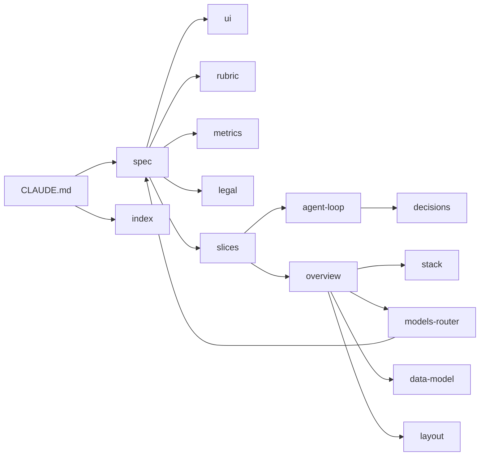

# TalentVisor — Índice da documentação

> Constituição do projeto: [CLAUDE.md](../CLAUDE.md). Todo doc tem um link de volta para este índice e, no rodapé, a seção **Referenciado por** (backlinks gerados por `scripts/docs_links.py`).

## Ordem de leitura

1. [CLAUDE.md](../CLAUDE.md): regras absolutas e invariantes.
2. [SPEC](spec/spec.md): o que o sistema faz (REQs + aceite). Em inglês.
3. [UI spec](spec/ui.md): páginas, componentes, estados e textos. Em inglês.
4. [Visão geral da arquitetura](architecture/overview.md): fluxo e pipeline.
5. [Slices](plan/slices.md): o que construir e em que ordem.
6. [Agent Loop](process/agent-loop.md): como os agentes constroem.

## Mapa

| Área | Documento | Conteúdo | Idioma |
|---|---|---|---|
| Spec | [spec.md](spec/spec.md) | REQs funcionais, legais, NF, qualidade; contrato JSON; API; estados; rastreabilidade | EN |
| Spec | [ui.md](spec/ui.md) | layout, 8 telas, componentes, HTMX, aceite de UI | EN |
| Arquitetura | [overview.md](architecture/overview.md) | diagrama local × nuvem; pipeline E0–E7 | PT-BR |
| Arquitetura | [stack.md](architecture/stack.md) | 5 alternativas avaliadas; stack por camada; Docker; Makefile | PT-BR |
| Arquitetura | [models-router.md](architecture/models-router.md) | modelos M1–M5; roteador de 3 camadas | PT-BR |
| Arquitetura | [data-model.md](architecture/data-model.md) | tabelas SQLite, TTL, purge | PT-BR |
| Arquitetura | [layout.md](architecture/layout.md) | árvore de pastas e arquivos | PT-BR |
| Domínio | [rubric.md](domain/rubric.md) | ideia central, rubrica 1/3/5, perguntas, categorias | PT-BR |
| Domínio | [metrics.md](domain/metrics.md) | métricas de performance; gatilhos de revisão | PT-BR |
| Domínio | [legal.md](domain/legal.md) | regras LGPD invioláveis | PT-BR |
| Domínio | [dataset.md](domain/dataset.md) | formato e restrições do dataset real | PT-BR |
| Plano | [slices.md](plan/slices.md) | S0–S7, tasks T-NN, riscos, DoD | PT-BR |
| Processo | [agent-loop.md](process/agent-loop.md) | 3 agentes, classes S/M/L, loop, regras git | PT-BR |
| Processo | [decisions.md](process/decisions.md) | log de decisões (caveman) | PT-BR |

## Regras dos docs

- Link sempre **relativo** (`../spec/spec.md`), nunca absoluto. Assim o Graphify e o GitHub resolvem os links.
- Ao criar ou renomear um doc: adicionar a linha no mapa acima e rodar `make test` (o `docs_links.py --check` falha com link quebrado ou backlink desatualizado).
- Uma mudança de comportamento começa na [SPEC](spec/spec.md) e é registrada em [decisions](process/decisions.md).

<!-- backlinks:start -->
---
**Referenciado por:** [CLAUDE.md](../CLAUDE.md) · [Modelo de dados (SQLite)](architecture/data-model.md) · [Estrutura de pastas](architecture/layout.md) · [Modelos e roteador de LLMs](architecture/models-router.md) · [Visão geral da arquitetura](architecture/overview.md) · [Stack e alternativas avaliadas](architecture/stack.md) · [Dataset](domain/dataset.md) · [Regras legais e éticas](domain/legal.md) · [Métricas e gatilhos de revisão](domain/metrics.md) · [Rubrica, perguntas e categorias](domain/rubric.md) · [Slices, tasks e Definition of Done](plan/slices.md) · [Agent Loop (SDD) do TalentVisor](process/agent-loop.md) · [Decisões (caveman)](process/decisions.md) · [TalentVisor — Specification (SDD)](spec/spec.md) · [TalentVisor — Web UI Specification](spec/ui.md)
<!-- backlinks:end -->
