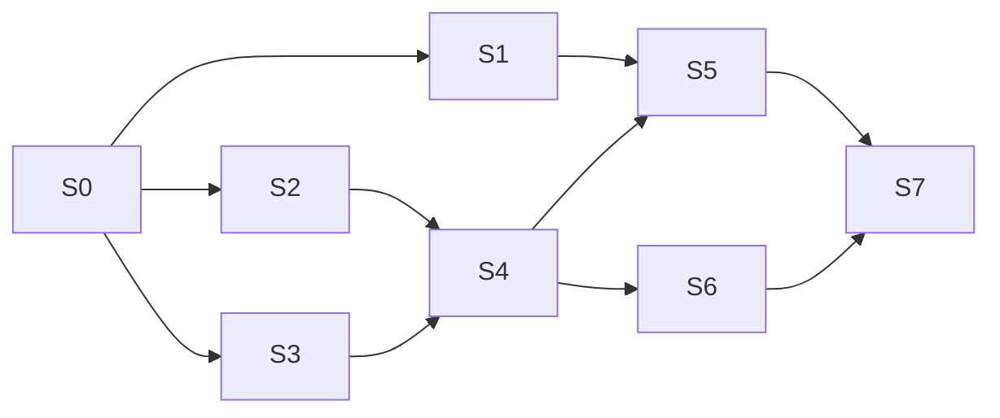

# Slices, tasks e Definition of Done

> [Índice](../index.md) · [SPEC](../spec/spec.md) · [UI spec](../spec/ui.md) · [Agent Loop](../process/agent-loop.md) · [Estrutura](../architecture/layout.md)

Cada **slice** é uma fatia vertical que termina com algo **demonstrável** rodando no Docker.
As tasks mantêm o ID `T-NN` (rastreabilidade com a [SPEC §11](../spec/spec.md)).

- Agente: `[OPUS]` tv-architect, `[SONNET]` tv-builder, `[HAIKU]` tv-runner, `[FELIPE]`.
- Revisão: **R-S** pelo Sonnet, **R-O** pelo Opus.
- Prioridade: **P0** é MVP, **P1** se der tempo, **P2** é extra.

## S0: infra e chaves (demo: `make up` → `make health` verde)
- [x] **T-00** `[FELIPE]` Chaves no `.env`; `M5_MODEL=gemini-4-hydrogen`; todos os IDs validados por `scripts/check_models.py` (24/11). *P0 · NF-03*
- [x] **T-01** `[SONNET]` `git init`, `pyproject` + `uv.lock`, Dockerfile, `compose.yaml`, Makefile, `.dockerignore`, `GET /health`. *P0 · NF-06, NF-07* · R-S
- [x] **T-02** `[HAIKU]` Graphify: `uv tool install graphifyy && graphify install --project && graphify update .` *P1*

## S1: esqueleto andando (demo: upload no navegador → linha "received" no painel)
- [x] **T-03** `[SONNET]` `db.py`: tabelas do [modelo de dados](../architecture/data-model.md), engine, `purge_expired()`. *P0 · L-01, L-05* · R-S
- [x] **T-04** `[SONNET]` `app.py` + `base.html` (Pico + HTMX): consentimento → upload → enviado + lista mínima no painel. *P0 · F-01, F-02, NF-04* · R-S

## S2: fala → texto (demo: vídeo vira transcrição; `uploads/` vazio)
- [x] **T-06** `[SONNET]` `stt.py` faster-whisper + qualidade + apagar o vídeo em `finally`. *P0 · F-04, L-01* · **R-O**
- [x] **T-07** `[SONNET]` Fallback Groq em chunks com o fim do chunk anterior como `prompt`, atrás da flag. *P1 · F-05* · R-S

## S3: privacidade e guarda (demo: nome some do texto; injeção marcada)
- [x] **T-08** `[SONNET]` `privacy.py`: PII do CSV + regex + spaCy NER. *P0 · F-06, L-04* · **R-O**
- [x] **T-09** `[SONNET]` Injeção: heurística + Prompt Guard + delimitadores escapados. *P0 · F-07* · **R-O**

## S4: juiz e roteador (demo: notas com evidência + log do roteador)
- [x] **T-10** `[SONNET]` `llm.py`: cliente OpenAI-compat, mock, `llm_cache`, Pydantic + retry, assert anti-PII. *P0 · F-08, L-04* · **R-O**
- [x] **T-11** `[OPUS]` `prompts.py`: rubrica, âncoras, hard skills, perfil, categorias. *P0 · F-09, F-10* · R-O
- [x] **T-12** `[SONNET]` `router.py` 3 camadas + `router_log`. *P0 · F-11* · **R-O**
- [x] **T-13** `[SONNET]` `pipeline.py`: E0–E6, mediana de 3 runs, auditor, gatilhos de revisão. `POST /api/evaluate` entregue junto com os fixes da S4 (D-042). *P0 · F-12, F-13, L-03* · **R-O**

## S5: recrutador e PDF (demo: decidir → nome revelado → PDF)
- [x] **T-14** `[SONNET]` Painel completo + detalhe do candidato + decisão humana via HTMX. *P0 · F-14, F-15* · R-S
- [x] **T-15** `[SONNET]` `report.py` + `report.html` → PDF (rascunho antes da decisão). *P0 · F-16* · R-S
- [x] **T-16** `[HAIKU]` Contestação do candidato. *P2 · F-17*

## S6: dataset e qualidade (demo: C002 recusado; eval e bias verdes)
- [x] **T-05** `[SONNET]` `import_dataset.py` + `make import` (recusa `cleared≠Sim`). *P0 · F-03, L-06* · R-S
- [x] **T-17** `[SONNET]` `fixtures/synthetic.json` (5 casos) + `scripts/eval.py`. *P1 · Q-01* · R-S
- [x] **T-18** `[SONNET]` `scripts/bias_check.py` (Δ≤1). *P1 · Q-02, L-07* · R-S
- [x] **T-19** `[SONNET]` `metrics.py` + bloco de métricas no painel + check de P/R da anonimização (movido da T-08). *P1 · Q-03* · R-S

## S7: ponta a ponta e auditoria (demo: o fluxo completo com chaves reais)
- [x] **T-20** `[HAIKU]` E2E real: C001 e C003 processados, C002 recusado, `eval.py` anexado → `[OPUS]` valida o aceite. *P0* · saídas cruas (só fixtures sintéticas): [t20-eval-real.txt](../evidence/t20-eval-real.txt), [t20-bias-real.txt](../evidence/t20-bias-real.txt)
- [x] **T-21** `[OPUS]` `/ponytail-audit` + `graphify update .` + revisão final contra a SPEC. *P1*

S2 e S3 rodam **em paralelo** (arquivos disjuntos). Até o S7 tudo roda com `LLM_MODE=mock`; as chaves só são exigidas no E2E real.

## Riscos

| Risco | Prob. | Mitigação |
|---|---|---|
| Sem chaves a tempo | média | `LLM_MODE=mock` + `llm_cache` com respostas reais gravadas para a apresentação |
| Rate limit no free tier (429) | alta | cooldown no roteador, cache, 3 runs só no E4 |
| STT lento em CPU | média | `large-v3-turbo` int8 + VAD; o vídeo de 4 min leva cerca de 1–2 min |
| ID de modelo mudou | média | IDs no `.env`, conferidos na T-00 |
| JSON do LLM inválido | média | `json_schema` + Pydantic + 1 retry + cascata |
| NER falha num nome raro | média | PII do CSV tem prioridade; P/R medido; NER é só reforço |
| Dados reais vazarem no git | baixa | `.gitignore` em `data/`, `*.mp4`, `*.zip`, `.env` desde já |
| Imagem grande e build lento (modelo STT embutido ~1,6 GB) | média | camada do modelo separada e cacheada; o rebuild só muda a camada do código |

## Definition of Done (MVP)

- [ ] C001 e C003 percorrem o fluxo upload/import → painel → decisão → PDF; o C002 é recusado com mensagem. Feito: import real com C001 e C003 avaliados e C002 recusado ([D-054](../process/decisions.md), [D-056](../process/decisions.md)); decisão e PDF cobertos em mock (`test_decision_writes_audit`, `test_pdf_route`). O passo decisão → PDF com dados reais é feito pelo recrutador humano durante a demo: um agente não pode gravar decisão de recrutador (REQ-L-03). O `audit_unavailable` do C001 veio da lógica do E6 anterior à D-055; no dia da demo, de manhã, roda-se um import novo com cota cheia.
- [x] Nenhum vídeo ou áudio em disco após o E1; nenhuma chamada de nuvem com o nome real. Evidência: `test_full_mock_run`, `test_video_deleted_even_on_error`, `test_aborts_on_pii`; run real com vídeo apagado mesmo no erro ([D-054](../process/decisions.md)).
- [x] `eval.py`: ordena ótima > média > ruim; Δ(informal)≤1; injeção sem efeito e marcada para revisão. Evidência: Q-01 e Q-02 PASS no run real ([D-054](../process/decisions.md); [t20-eval-real.txt](../evidence/t20-eval-real.txt), [t20-bias-real.txt](../evidence/t20-bias-real.txt)).
- [x] Painel mostra o log do roteador, o selo de revisão com o motivo e o aviso fixo. Evidência: `test_detail_renders_skills`, `test_detail_shows_router_log`, `test_dashboard_filters_and_review`.
- [ ] `make up` numa máquina limpa (só Docker) sobe e `make health` fica verde. Falta: conferir num clone limpo (manual, NF-06).
- [ ] `make test` verde (pytest + ruff + `docs_links --check`). Marcar depois do último `make test` antes do commit.

<!-- backlinks:start -->
---
**Referenciado por:** [CLAUDE.md](../../CLAUDE.md) · [TalentVisor — Índice da documentação](../index.md) · [Agent Loop (SDD) do TalentVisor](../process/agent-loop.md) · [TalentVisor — Specification (SDD)](../spec/spec.md) · [TalentVisor — Web UI Specification](../spec/ui.md)
<!-- backlinks:end -->
