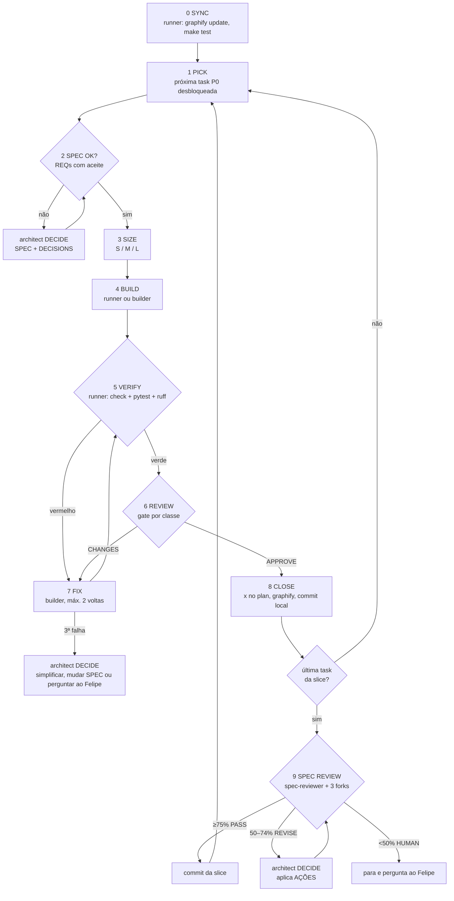

# Agent Loop (SDD) do TalentVisor

> [Índice](../index.md)

Como a construção acontece. Quem orquestra é a **sessão principal** (Claude Opus): ela escolhe a task, monta o pacote, despacha o agente certo e fecha o ciclo.

## Artefatos SDD

| Arquivo | Papel no SDD | Quem altera |
|---|---|---|
| [CLAUDE.md](../../CLAUDE.md) | constituição: regras que nunca mudam no meio da construção | Felipe (com sugestão do architect) |
| [SPEC](../spec/spec.md) + [UI spec](../spec/ui.md) | **o quê**: REQs + critérios de aceite | tv-architect (modo DECIDE) |
| [Arquitetura](../architecture/overview.md) | **como**: stack, modelos, roteador, dados, pastas | tv-architect |
| [Slices](../plan/slices.md) | **quando**: tasks com checkbox | orquestrador; tv-runner marca o `[x]` |
| [Decisões](decisions.md) | **por quê**: log de decisões em formato caveman | tv-architect |
| `tests/` | prova de que cada REQ vale | tv-builder |

Ordem de autoridade: [CLAUDE.md](../../CLAUDE.md) > [SPEC](../spec/spec.md) > [Slices](../plan/slices.md) > código. Se o código diverge da SPEC, quem está errado é o código, até que uma decisão mude a SPEC.

## Os 3 agentes

| Agente | Modelo | Modos | Skills e ferramentas |
|---|---|---|---|
| `tv-architect` | Opus | PLAN, BRAINSTORM, DECIDE, REVIEW-L, WRITE-PROMPTS | `caveman` (decisões), `ponytail:ponytail-review`, `ponytail:ponytail-audit`, Graphify |
| `tv-builder` | Sonnet | BUILD, REVIEW-M | `ponytail:ponytail`, `ponytail:ponytail-review`, Graphify, Serena |
| `tv-runner` | Haiku | RUN (ler, testar, setup, edição pequena) | Bash, Read, Edit |
| `tv-spec-reviewer` | Opus | SPEC REVIEW (fim de slice) | 3 forks Opus (otimista, neutra, pessimista) + síntese modesta |

## Classificação por tamanho (define quem constrói e quem revisa)

| Classe | Critério (qualquer item já classifica) | Constrói | Revisa |
|---|---|---|---|
| **S** | ≤ 30 linhas, 1 arquivo, sem lógica nova; ou config, docs, comando | tv-runner | nenhum (o check basta) |
| **M** | ≤ 200 linhas, ≤ 3 arquivos, fora do caminho crítico | tv-builder | tv-builder (REVIEW-M, **instância nova**) |
| **L** | > 200 linhas, **ou** > 3 arquivos, **ou** caminho crítico, **ou** `graphify query` mostra > 5 dependentes do símbolo alterado | tv-builder | **tv-architect (REVIEW-L)** |

**Caminho crítico:** `privacy.py`, `router.py`, `pipeline.py`, `stt.py`, `llm.py`, `prompts.py` e a rota de decisão em `app.py`.
Exceção: o `prompts.py` (T-11) é **escrito** pelo tv-architect e revisado por uma instância nova de tv-architect.

## O loop



| Passo | Quem | O que acontece | Sai com |
|---|---|---|---|
| 0 SYNC | runner | `make status`, `graphify update .`, `make test`, resumo do estado | baseline verde (ou a lista do que está vermelho) |
| 1 PICK | orquestrador | P0 antes de P1; respeita as dependências do grafo em [Slices](../plan/slices.md); até **2 builders em paralelo** só se os FILES forem disjuntos | task escolhida |
| 2 SPEC | orquestrador → architect | todos os REQs da task têm Dado/Quando/Então e teste em §11? Se faltar, DECIDE | REQs fechados |
| 3 SIZE | orquestrador | aplica a tabela de classes; o `graphify query` pode subir a classe | S, M ou L |
| 4 BUILD | runner/builder | executa o pacote da task (formato abaixo) | relatório `STATUS/FILES/CHECK` |
| 5 VERIFY | runner | `make test` (suíte inteira + ruff no container), **independente** do builder | verde ou vermelho |
| 6 REVIEW | builder novo / architect | REVIEW-M ou REVIEW-L | APPROVE, CHANGES ou ESCALATE |
| 7 FIX | builder | aplica os CHANGES; volta ao 5; **limite de 2 voltas** | n/a |
| 8 CLOSE | runner + orquestrador | `[x]` no [Slices](../plan/slices.md), `graphify update .`; o **orquestrador** faz um commit local (mensagem em inglês, sem co-author, sem push) | task fechada |
| 9 SPEC REVIEW | tv-spec-reviewer (Opus) | só na **última task da slice**. Dispara os 3 forks com os prompts prontos do agente e sintetiza a visão modesta: `NOTA x/5`, `CONFIANÇA %`, `MOTIVO`, `AÇÕES`, `GATE`. **PASS** (≥ 75%) → commit `docs(spec): review S<n>` se houve ajuste e segue para a próxima slice. **REVISE** (50–74%) → tv-architect DECIDE aplica as AÇÕES e o gate roda de novo (máx. 2 voltas, depois HUMAN). **HUMAN** (< 50%) → para e pergunta ao Felipe ([D-020](decisions.md)) | slice fechada |

### Live ops (o que o Felipe vê)

Cada passo acima gera um evento em `ops/events.jsonl` (fora do git), gravado pelo orquestrador:

```bash
python3 scripts/ops.py log task=T-03 step=BUILD agent=tv-builder model=sonnet status=start msg="db.py"
```

- `status`: `start`, `ok`, `fail`, `changes`, `approve`, `pass`, `revise`, `human`.
- No PICK/SIZE: `size=S|M|L` (vira a classe no card "Agora").
- Na revisão da SPEC: o revisor loga `step=SPEC_REVIEW agent=tv-spec-reviewer score=4.2 conf=80 gate=PASS`; cada fork loga `agent=fork-<visão> status=done score=… conf=…` (vira o ponto do fork na barra). No commit: `step=COMMIT msg=<hash> <assunto>`.
- `make ops` serve o dash em http://localhost:8001: a página `scripts/ops.html` lê `/state.json` (montado pelo `ops.py` a partir do `events.jsonl` e do [Slices](../plan/slices.md)) a cada 1 s em páginas trocadas pela nav (Agora, Slices, Agentes, Spec review, Commits, Eventos; `#hash` na URL) ([D-021](decisions.md)).

### Pacote da task (o que o orquestrador envia)

```
MODE: BUILD
TASK: T-08 — anonimização local
REQ: REQ-F-06, REQ-L-04
FILES: talentvisor/privacy.py, tests/test_privacy.py
DONE WHEN:
  - valores conhecidos do candidato substituídos por [NOME]/[INSTITUICAO]/[LOCAL]
  - regex CPF/OAB/e-mail/telefone
  - NER spaCy PER/LOC/ORG
  - P/R ≥ 0,95 sobre o PII do CSV
CHECK: make test T=tests/test_privacy.py
CONTEXT: graphify query "anonimizar"; SPEC §5.1 REQ-F-06
CLASS: L (caminho crítico) → review: tv-architect
```

### Regras de parada e escalonamento

- **ESCALATE_HUMAN** (para e pergunta ao Felipe): escopo, questão legal ou ética, chaves e contas, qualquer ação irreversível (push, apagar dado real), conflito entre [CLAUDE.md](../../CLAUDE.md) e um pedido.
- **3ª falha** no mesmo FIX → o architect decide se simplifica, divide a task ou muda a SPEC.
- **Contexto:** os agentes recebem o pacote e os caminhos, nunca o conteúdo inteiro de arquivos grandes; o Graphify aponta onde ler.
- **Sem rede nos testes:** `LLM_MODE=mock` sempre. As chamadas reais só acontecem na T-20.
- **Git:** só o orquestrador commita. Mensagem em inglês (`feat(privacy): …`), stage por nome de arquivo, **sem** `Co-Authored-By` e sem menção a Claude. **Nunca** `git push`. Co-author só na descrição de PR.
- **Idioma:** código, comentários, SPEC e commits em inglês; docs em PT-BR; texto da UI e do relatório em PT-BR.
- **Dados reais:** o dataset do zip **nunca** é copiado para `tests/` e nunca vai para o git. Os testes usam `tests/fixtures/sinteticos.json`.

## Quando usar cada skill e ferramenta

| Situação | Ferramenta |
|---|---|
| Antes de editar código compartilhado | `graphify query "<símbolo>"` / `graphify explain "<símbolo>"` |
| Depois de fechar uma task | `graphify update .` (ou `graphify hook install` para rebuild no commit) |
| Escrever código | skill `ponytail:ponytail` (escada do mínimo) |
| Revisar diff M ou L | skill `ponytail:ponytail-review` + checklist de REQs |
| Fim de fase / T-21 | skill `ponytail:ponytail-audit` no repo inteiro |
| Registrar uma decisão | skill `caveman` → linha no [Decisões](decisions.md) |
| Ler ou editar símbolo de código | Serena (`find_symbol`, `replace_symbol_body`) |

<!-- backlinks:start -->
---
**Referenciado por:** [CLAUDE.md](../../CLAUDE.md) · [TalentVisor — Índice da documentação](../index.md) · [Slices, tasks e Definition of Done](../plan/slices.md) · [Decisões (caveman)](decisions.md)
<!-- backlinks:end -->
